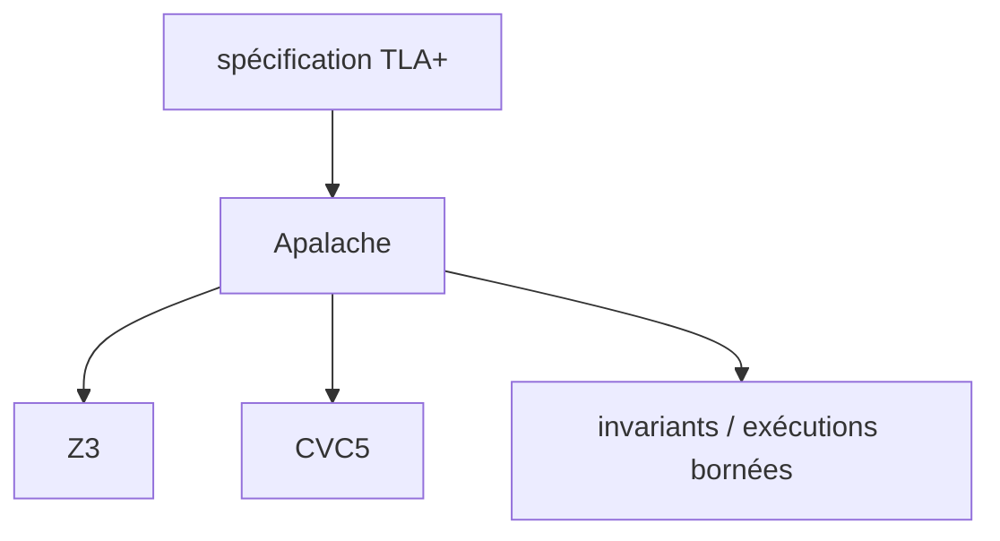

# apalache-mc/apalache

> Symbolic model checker for TLA+ built on SMT solvers, for distributed-systems engineers.

## The problem
Verifying TLA+ specifications with large state spaces (integer clocks, Byzantine faults) goes beyond what TLC can explore.

## What it actually does
Translates TLA+ into the logic of SMT solvers (Z3, CVC5). It checks inductive invariants (fixed or bounded parameters) and the safety of bounded executions. It starts from the same assumptions as TLC. Governed by a technical charter, under the Linux Foundation (LF Projects).

## How it is wired
Simplified diagram based on the sheet, no diagram provided.


## Trying it
```bash
docker pull ghcr.io/apalache-mc/apalache:main
```

## Cost and gotchas
Free. A real JVM is needed if you take the jar. 263 open issues. Requires mastery of TLA+.

## What it is not
It is not a tool for verifying ordinary code: it verifies specifications, not your implementation.

## Alternatives
- TLC: exploration-based model checker that the README cites as the reference.

## For you
Worth watching: relevant if you specify distributed systems in TLA+, foreign to everyday data / AI work.
