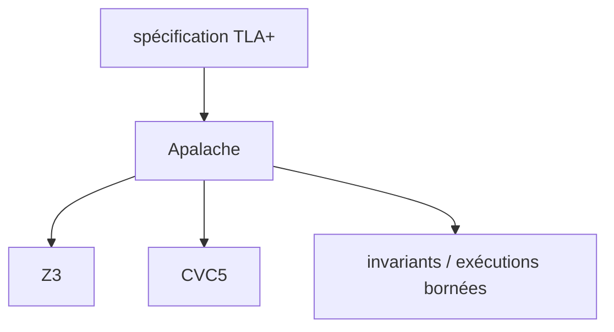

# apalache-mc/apalache

> Vérificateur symbolique de modèles TLA+ qui s'appuie sur des solveurs SMT, pour ingénieurs de systèmes distribués.

## Le problème
Vérifier des spécifications TLA+ à grands espaces d'états (horloges entières, fautes byzantines) dépasse ce que TLC explore.

## Ce que ça fait vraiment
Traduit TLA+ vers la logique des solveurs SMT (Z3, CVC5). Il vérifie des invariants inductifs (paramètres fixes ou bornés) et la sûreté d'exécutions bornées. Il part des mêmes hypothèses que TLC. Gouverné par une charte technique, sous Linux Foundation (LF Projects).

## Comment c'est branché
Schéma simplifié d'après la fiche, sans diagramme fourni.


## Essayer
```bash
docker pull ghcr.io/apalache-mc/apalache:main
```

## Coût et pièges
Gratuit. Besoin réel d'une JVM si tu prends le jar. 263 issues ouvertes. Demande de maîtriser TLA+.

## Ce que ce n'est pas
Ce n'est pas un outil pour vérifier du code ordinaire : il vérifie des spécifications, pas ton implémentation.

## Alternatives
- TLC : modèle d'exploration que le README cite comme référence.

## Pour toi
À surveiller : pertinent si tu spécifies des systèmes distribués en TLA+, étranger au travail data / IA courant.

