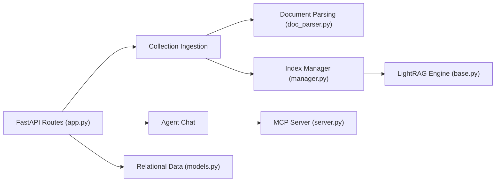

# apecloud/ApeRAG

> Self-hosted RAG platform combining graph, vectors and full text, with agents and MCP, for AI teams.

## The problem
Building a knowledge base that an LLM can query requires assembling parsing, a vector index, a graph, full-text search and agents.

## What it actually does
FastAPI API, React interface and Celery tasks. Five index types (vector, full text, graph, summary, vision), a graph engine derived from LightRAG with entity merging, advanced parsing via MinerU (optional GPU), agents with MCP tools and web search, audit log. Helm/KubeBlocks deployment for PostgreSQL, Redis, Qdrant, Elasticsearch, Neo4j.

## How it is wired


## Trying it
```bash
git clone https://github.com/apecloud/ApeRAG.git
cd ApeRAG
cp envs/env.template .env
docker-compose up -d --pull always
```
Interface at `http://localhost:3000/web/`, API at `http://localhost:8000/docs`.

## Cost and gotchas
Minimum 2 cores, 4 GB of RAM, Docker. The `doc-ray` service requires 4+ cores and 8 GB+. An LLM key is at your expense (not detailed in this README).

## What it is not
Not a simple library: it is a full stack with four databases in Kubernetes mode. The "best choice" wording in the README is marketing.

## Alternatives
LightRAG: the graph engine ApeRAG builds on.

## For you
Worth watching: relevant if you want a turnkey RAG with a graph and accept the infrastructure; for a prototype, LightRAG alone is lighter.
