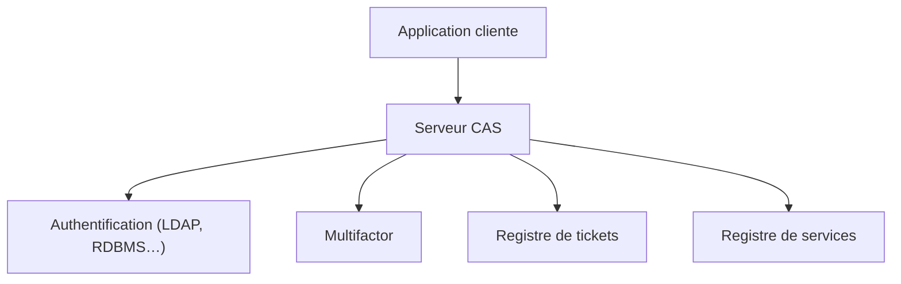

# apereo/cas

> Java single sign-on server and identity provider, to secure access to many applications.

## The problem
Each application manages its own authentication: multiple passwords, no shared MFA, repeated directory integration.

## What it actually does
A Spring Boot server that speaks CAS, SAML2, OAuth 2.0 and OpenID Connect, with LDAP authentication, SQL database, X.509, passkeys and several factors (Duo, WebAuthn, YubiKey). It handles delegation to external providers, ticket registries (Hazelcast, Redis, JPA…) and operations dashboards. It runs on Tomcat or Jetty, in Docker or Kubernetes.

## How it is wired
Simplified diagram based on the sheet, no diagram provided.


## Trying it
```bash
docker run --rm -p 8080:8080 \
  -e SERVER_SSL_ENABLED=false -e SERVER_PORT=8080 \
  apereo/cas:<version>
# http://localhost:8080/cas/login  (casuser / Mellon)
```

## Cost and gotchas
Free. A real installation goes through a configured WAR overlay and a directory or user database; several maintenance branches coexist.

## What it is not
Not a turnkey solution: it is an identity server to configure and operate yourself.

## Alternatives
- Keycloak: cited in the README as a possible integration, not as a direct competitor.

## For you
Keep an eye on it: useful if your MLOps platform requires centralized authentication, otherwise its operational burden is disproportionate.
