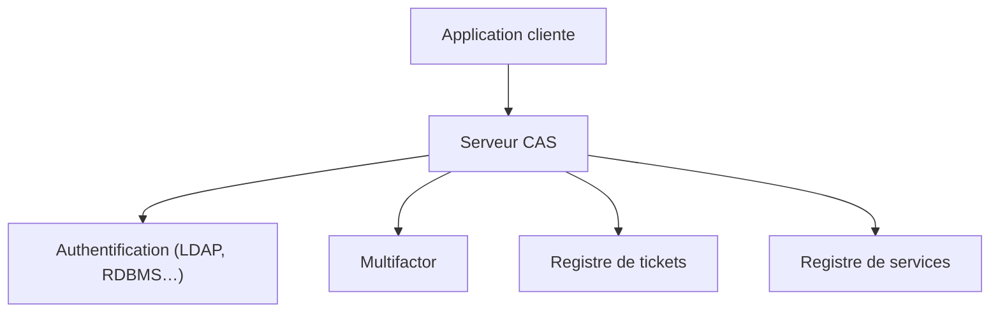

# apereo/cas

> Serveur Java de connexion unique et fournisseur d'identité, pour sécuriser l'accès à de nombreuses applications.

## Le problème
Chaque application gère sa propre authentification : mots de passe multiples, pas de MFA commune, intégration d'annuaires répétée.

## Ce que ça fait vraiment
Un serveur Spring Boot qui parle CAS, SAML2, OAuth 2.0 et OpenID Connect, avec authentification LDAP, base SQL, X.509, passkeys et plusieurs facteurs (Duo, WebAuthn, YubiKey). Il gère la délégation à des fournisseurs externes, des registres de tickets (Hazelcast, Redis, JPA…) et des tableaux de bord d'exploitation. Il tourne sur Tomcat ou Jetty, en Docker ou Kubernetes.

## Comment c'est branché
Schéma simplifié d'après la fiche, sans diagramme fourni.


## Essayer
```bash
docker run --rm -p 8080:8080 \
  -e SERVER_SSL_ENABLED=false -e SERVER_PORT=8080 \
  apereo/cas:<version>
# http://localhost:8080/cas/login  (casuser / Mellon)
```

## Coût et pièges
Gratuit. Une vraie installation passe par un overlay WAR configuré et un annuaire ou une base d'utilisateurs ; plusieurs branches de maintenance coexistent.

## Ce que ce n'est pas
Pas une solution clé en main : c'est un serveur d'identité à configurer et exploiter soi-même.

## Alternatives
- Keycloak : cité dans le README comme intégration possible, pas comme concurrent direct.

## Pour toi
À surveiller : utile si ton plateforme MLOps demande une authentification centralisée, sinon sa charge d'exploitation est disproportionnée.

