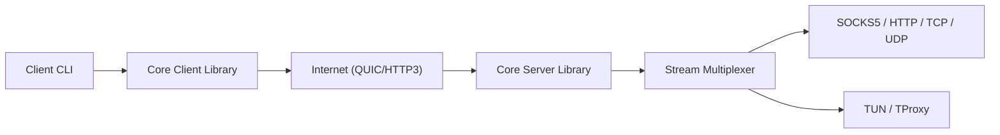

# apernet/hysteria

> QUIC-based proxy written in Go, designed to resist censorship.

## The problem
Getting around network restrictions with a fast proxy that is hard to identify.

## What it actually does
The README is reduced to badges, links and a slogan. From the code: Go client and server with a custom protocol on top of QUIC, disguised as HTTP/3, several proxy modes (SOCKS5, HTTP, TCP/UDP forwarding, TProxy, TUN), pluggable authentication and access control, congestion control (BBR mentioned), obfuscation and traffic logging in `extras/`.

## How it is wired

## Trying it
No command documented in the README provided; the documentation is on the project's website.

## Cost and gotchas
Free. Requires a server of your own (not specified in the README provided). A 1.x version is flagged as old. Depends on whether such use is legal in your country.

## What it is not
It is not a turnkey VPN nor a guaranteed anonymity tool. The README provided documents nothing about usage.

## Alternatives
No alternative named in the README.

## For you
Ignore: insufficient README material, and a network circumvention tool unrelated to data/AI/MLOps work.
