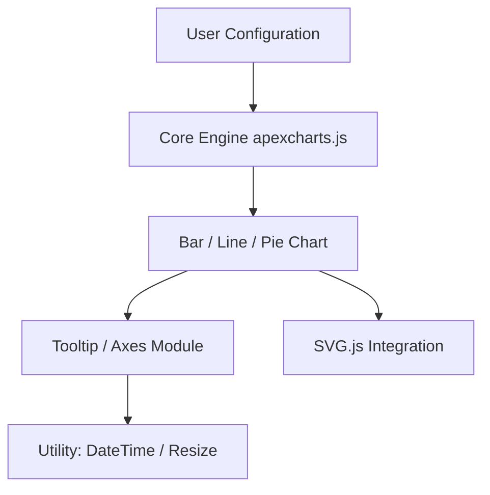

# apexcharts/apexcharts.js

> JavaScript library for interactive charts in web dashboards, SSR-compatible.

## The problem
Building interactive charts in a web app without depending on D3 and its low-level code.

## What it actually does
More than 18 chart types (line, bar, heatmap, treemap, candlestick, violin…), in SVG, with canvas rendering for dense series.
Server-side rendering (Next, Nuxt, SvelteKit) then hydration. You can import only the pieces you need to lighten the bundle. TypeScript types included.
v6 brings plugins, undo/redo, crossfilter, annotation editing and streaming.
Wrappers exist for React, Vue, Angular and Blazor.

## How it is wired


## Trying it
```bash
npm install apexcharts
```

## Cost and gotchas
Some features are paid (unit, raincloud, crossfilter, history, perspectives…). Without a key, an "APEXCHARTS" watermark appears on charts that use them.

## What it is not
Not a Python library: for your notebooks, it is not the tool. "Free for most users" is not a clear open-source license, and GitHub does not identify it.

## Alternatives
The README only names its own wrappers (react-apexcharts, vue3-apexcharts…), not competitors.

## For you
Ignore: it is JS front-end with an ambiguous license. For your visualizations, stay on the Python ecosystem.
