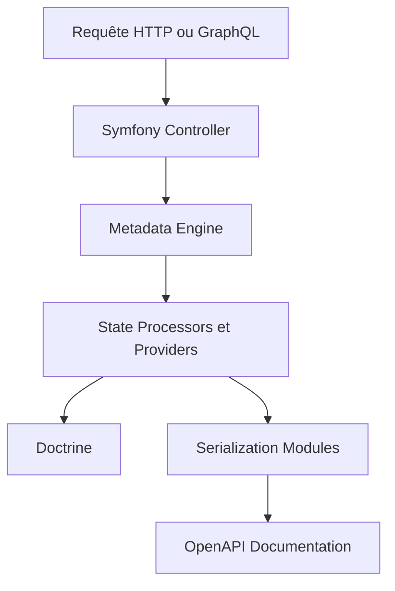

# api-platform/core

> PHP library for building hypermedia-driven REST and GraphQL APIs, integrated with Symfony.

## The problem
Building a complete API (formats, documentation, filters, pagination) in PHP takes a lot of repetitive code.

## What it actually does
A metadata engine describes the resources, state processors and providers handle data access (Doctrine, Elasticsearch, GraphQL), serializers produce JSON-LD, Hydra, JSON:API, HAL, OpenAPI. Integrations exist for Symfony and, judging by the tree, Laravel.

## How it is wired

## Trying it
No command in the README; it points to the official site's documentation.

## Cost and gotchas
Free. PHP and Symfony required (not listed: `aucun`). The short README does not detail installation.

## What it is not
Not a standalone framework: it plugs into Symfony or Laravel. Not data- or AI-oriented.

## Alternatives
No alternative named in the README.

## For you
Ignore: PHP ecosystem, whereas a data / AI / MLOps profile exposes its APIs with FastAPI or equivalent.
