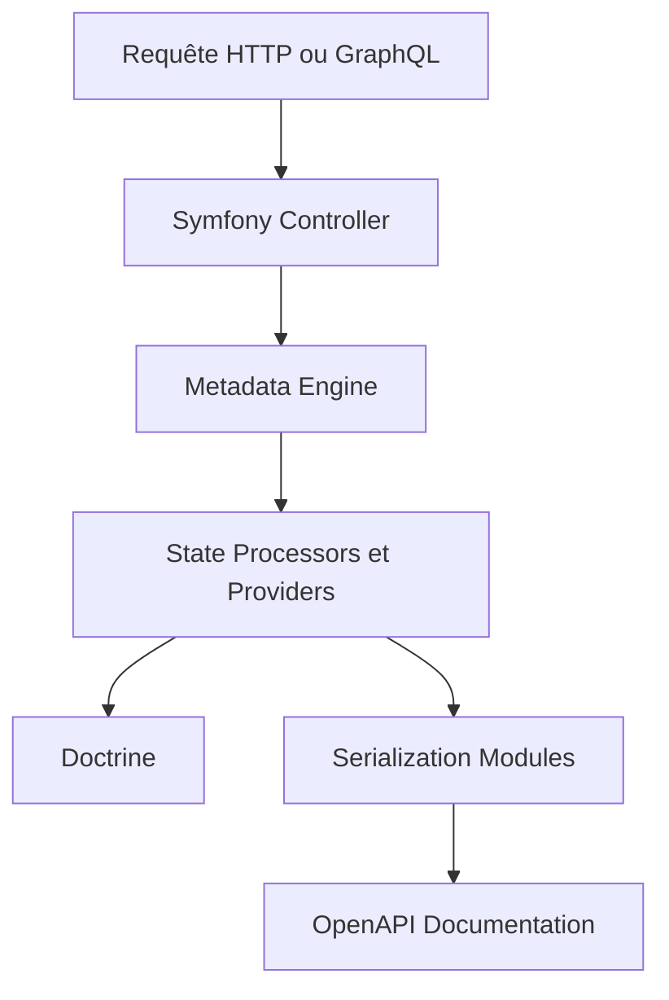

# api-platform/core

> Bibliothèque PHP pour créer des API REST et GraphQL pilotées par l'hypermédia, intégrée à Symfony.

## Le problème
Construire une API complète (formats, documentation, filtres, pagination) en PHP demande beaucoup de code répétitif.

## Ce que ça fait vraiment
Un moteur de métadonnées décrit les ressources, des processeurs et fournisseurs d'état gèrent l'accès aux données (Doctrine, Elasticsearch, GraphQL), des sérialiseurs produisent JSON-LD, Hydra, JSON:API, HAL, OpenAPI. Des intégrations existent pour Symfony et, d'après l'arborescence, Laravel.

## Comment c'est branché

## Essayer
Aucune commande dans le README ; il renvoie à la documentation du site officiel.

## Coût et pièges
Gratuit. PHP et Symfony requis (non listés : `aucun`). Le README court ne détaille pas l'installation.

## Ce que ce n'est pas
Pas un framework autonome : il se greffe sur Symfony ou Laravel. Pas orienté données ni IA.

## Alternatives
Aucune alternative nommée dans le README.

## Pour toi
Ignorer : écosystème PHP, alors qu'un profil data / IA / MLOps expose ses API avec FastAPI ou équivalent.

