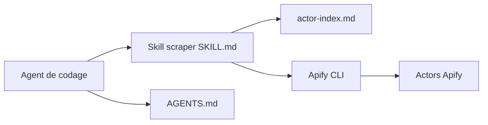

# apify/agent-skills

> Skills for coding agents: scraping via Apify Actors, creating and integrating Actors.

## The problem
A coding agent has to pick the right collection tool among thousands, shape its inputs and manage the runs.

## What it actually does
Five skills: `apify-ultimate-scraper` (130+ selected Actors, falling back to the catalog of more than 30,000), `apify-actor-development`, `apify-actorization`, `apify-generate-output-schema`, `apify-integration-development`, plus commands such as `/create-actor`. The agent chooses the Actor, prepares the input, launches the run and formats the results. The skills' instructions were not examined in the architecture.

## How it is wired


## Trying it
```bash
npx skills add https://github.com/apify/agent-skills --skill apify-ultimate-scraper
/plugin marketplace add https://github.com/apify/agent-skills
npm install -g apify-cli
apify login
```

## Cost and gotchas
Apify account (free tier), Apify CLI, Node 20.6+. Actors are billed per result or per event, set by each Actor. Scraping social networks raises questions about terms of use and personal data, not addressed in the README.

## What it is not
Not a standalone scraper: everything goes through the Apify platform, which is pay-per-use. No license declared in the catalog.

## Alternatives
The README cites `apify/awesome-skills` (community skills) and `mcp.apify.com` (hosted MCP server).

## For you
Worth watching: useful for feeding web datasets from an agent, but the pay-per-use cost and the lack of a license call for scoping before any lasting use.
