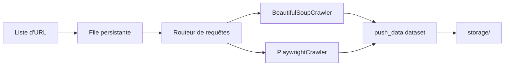

# apify/crawlee-python

> Asyncio crawling and scraping library, HTTP or browser, with a persistent queue.

## The problem
A hand-written scraper always ends up lacking retries on error, proxy rotation,
persistence of the URL queue and resumption after interruption.

## What it actually does
Two main crawlers sharing one interface: `BeautifulSoupCrawler`, which downloads over HTTP
(`ImpitHttpClient` client by default) and provides the parsed HTML, fast because it uses no browser;
`PlaywrightCrawler`, which drives a headless browser for pages that depend on client-side JavaScript.
Each crawler defines a request router, a `push_data` to a dataset and `enqueue_links` to
follow links. Automatic parallelism based on resources, retries on error or blocking,
proxy and session rotation, tabular or file storage in `storage/`.

## How it is wired


## Trying it
```sh
python -m pip install 'crawlee[all]'
playwright install
python -c 'import crawlee; print(crawlee.__version__)'
uvx 'crawlee[cli]' create my-crawler
```

## Cost and gotchas
Free and runs anywhere. Extras matter: `beautifulsoup` and `playwright` are installed
separately to limit the size, and Playwright then requires its browsers. Each run creates a
`storage/` directory in the current folder.

## What it is not
Not a stateless tool: queue and session persistence is the core, not an option.
Not a service: running on the Apify platform is offered, but that is a separate deployment.
The "almost human" behavior against anti-bot protections remains a claim from the README.

## Alternatives
- **Scrapy**: explicitly compared — no asyncio, no type annotations, with its own launcher.
- **Crawlee for JS/TS**: same library, Node ecosystem.

## For you
The right choice for building a durable data collector rather than a throwaway script.
