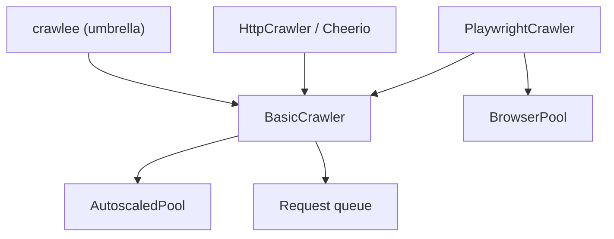

# apify/crawlee

> Node.js library for web scraping and browser automation, HTTP or headless.

## The problem
Writing reliable crawlers that handle URL queues, retries, proxies and anti-bot blocking.

## What it actually does
A single interface for HTTP (Cheerio, JSDOM) and browsers (Playwright, Puppeteer), persistent request queue, autoscaling based on CPU and memory, proxy and session rotation, browser fingerprints, dataset storage in `./storage`. Starter CLI and ready-made Dockerfiles.

## How it is wired


## Trying it
```bash
npx crawlee create my-crawler
cd my-crawler
npm start
npm install crawlee playwright
```

## Cost and gotchas
Node 22.13 or later. Playwright must be installed separately. Any proxies are at your expense; Apify deployment is optional.

## What it is not
Not a hosted service: the Apify platform is optional. Does not guarantee getting past all protections.

## Alternatives
- Crawlee for Python: Python version of the same project.

## For you
Adopt for feeding a dataset by scraping: mature, well equipped, Python version available.
