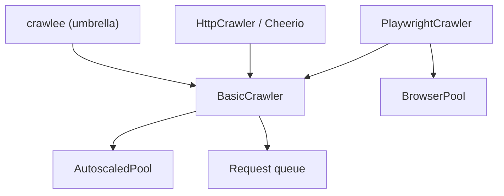

# apify/crawlee

> Bibliothèque Node.js de web scraping et d'automatisation de navigateur, HTTP ou headless.

## Le problème
Écrire des crawlers fiables qui gèrent file d'URL, retries, proxies et blocages anti-bots.

## Ce que ça fait vraiment
Interface unique pour HTTP (Cheerio, JSDOM) et navigateurs (Playwright, Puppeteer), file de requêtes persistante, autoscaling selon CPU et mémoire, rotation de proxies et sessions, empreintes de navigateur, stockage de datasets dans `./storage`. CLI de démarrage et Dockerfiles prêts.

## Comment c'est branché


## Essayer
```bash
npx crawlee create my-crawler
cd my-crawler
npm start
npm install crawlee playwright
```

## Coût et pièges
Node 22.13 ou plus. Playwright à installer séparément. Proxies éventuels à ta charge ; déploiement Apify optionnel.

## Ce que ce n'est pas
Pas un service hébergé : la plateforme Apify est facultative. Ne garantit pas de passer toutes les protections.

## Alternatives
- Crawlee for Python : version Python du même projet.

## Pour toi
À adopter pour alimenter un jeu de données par scraping : mature, bien outillé, version Python disponible.

