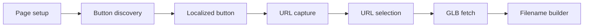

# apinanaivot/IKEA-3D-Model-Download-Button

> Tampermonkey script that adds a button to download the GLB 3D models from IKEA product pages.

## The problem
To try out furniture in 3D software, you need to get hold of the models that the site only shows in its own viewer.

## What it actually does
- Adds a "Download 3D" button next to "View in 3D" on product pages, in every language of the site.
- Finds the model URL, downloads it as a `.glb` and names it `[Product] - [Color].glb`.
- Watches dynamically loaded content and offers a manual selection of the button.
- A single source file: `ikea-3d-model-downloader.user.js`.

## How it is wired

## Trying it
Install the Tampermonkey extension, then add the script `ikea-3d-model-downloader.user.js`, enable it, and turn on developer mode on Chromium browsers.

## Cost and gotchas
Free. No license declared. The README asks you to respect IKEA's terms and to limit the models to personal use.

## What it is not
Not a 3D model library; it depends on the structure of IKEA's pages, which can change.

## Alternatives
No alternative named in the README.

## For you
Ignore: personal home-decor use, unrelated to data/AI/MLOps and with no clear license.
