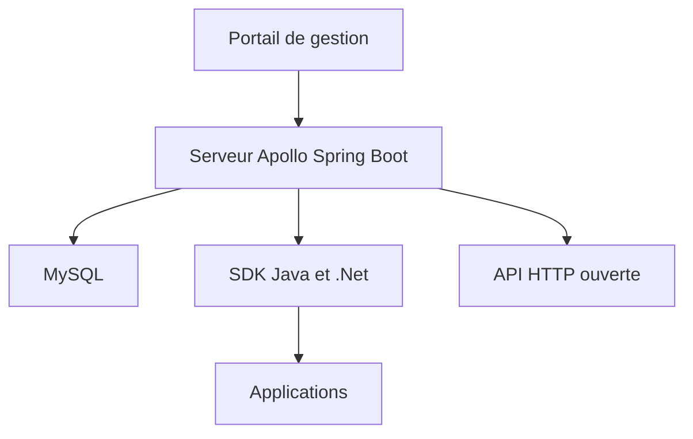

# apolloconfig/apollo

> Configuration center for microservices, with versioning, gradual release and SDKs, for platform teams.

## The problem
Managing the configurations of many applications, environments and clusters without a central tool leads to errors and changes that are hard to trace.

## What it actually does
Unified interface to manage configurations by environment, cluster and namespace. A published change reaches the SDKs in about one second. Each release is versioned (rollback possible), with gradual release to a portion of instances, separate edit and publish permissions, and an audit log. The server is based on Spring Boot and Spring Cloud; the only external dependency is MySQL.

## How it is wired
Simplified diagram based on the fiche, no diagram provided.

## Trying it
No command documented in the README: it points to Quick Start and Docker Quick Start.

## Cost and gotchas
Free. Requires Java and a MySQL database, which you operate yourself. A configuration center must be highly available: it is an infrastructure component to monitor. The Go, Python, Node, PHP and C SDKs are third-party projects.

## What it is not
Not a secrets manager. Not a Python tool. The README does not describe security or high availability; it points to separate pages.

## Alternatives
No alternative named in the README.

## For you
To watch: relevant if you run many deployed services with configurations that vary by environment; excessive for an isolated data project.
