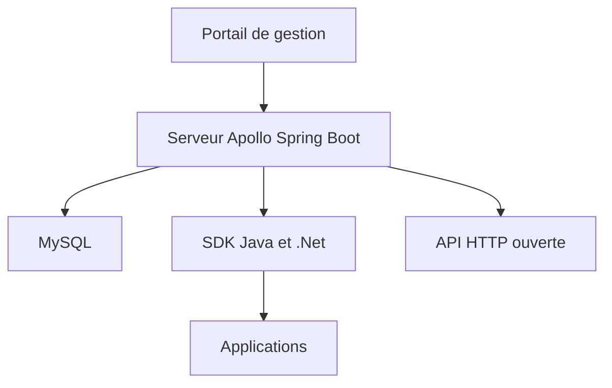

# apolloconfig/apollo

> Centre de configuration pour microservices, avec versions, publication progressive et SDK, pour équipes plateforme.

## Le problème
Gérer les configurations de nombreuses applications, environnements et clusters sans outil central donne des erreurs et des modifications difficiles à tracer.

## Ce que ça fait vraiment
Interface unifiée pour gérer les configurations par environnement, cluster et espace de noms. Une modification publiée parvient aux SDK en environ une seconde. Chaque publication est versionnée (retour arrière possible), avec publication progressive sur une partie des instances, droits d'édition et de publication séparés, et journal d'audit. Le serveur est basé sur Spring Boot et Spring Cloud ; la seule dépendance externe est MySQL.

## Comment c'est branché
Schéma simplifié d'après la fiche, sans diagramme fourni.

## Essayer
Aucune commande documentée dans le README : il renvoie vers Quick Start et Docker Quick Start.

## Coût et pièges
Gratuit. Il faut Java et une base MySQL, à exploiter toi-même. Un centre de configuration doit être très disponible : c'est une brique d'infrastructure à superviser. Les SDK Go, Python, Node, PHP, C sont des projets tiers.

## Ce que ce n'est pas
Ce n'est pas un gestionnaire de secrets. Ce n'est pas un outil Python. Le README ne décrit pas la sécurité ni la haute disponibilité ; il renvoie à des pages séparées.

## Alternatives
Aucune alternative nommée dans le README.

## Pour toi
À surveiller : pertinent si tu pilotes beaucoup de services déployés avec des configurations variables par environnement ; excessif pour un projet data isolé.

