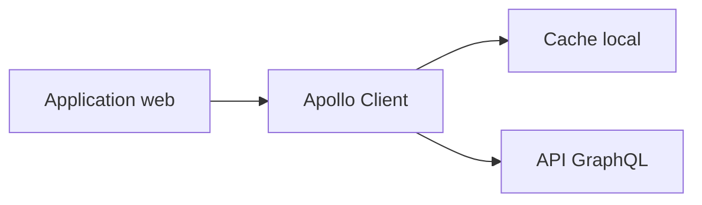

# apollographql/apollo-client

> GraphQL client for TypeScript and JavaScript with a cache, for web applications (React, Vue, Angular).

## The problem
Querying a GraphQL API while keeping consistent local state takes a lot of manual code.

## What it actually does
A GraphQL client with automatic caching, framework-independent (React, Vue, Angular, Svelte) and typed in TypeScript. The README highlights React 19 compatibility. It also offers a skill for AI agents, developer tools (VS Code extension, DevTools) and a course.

## How it is wired
Simplified diagram based on the sheet, no diagram provided.



## Trying it
```sh
npm install @apollo/client graphql
npx skills add apollographql/skills --skill apollo-client
```

## Cost and gotchas
Free (MIT). A GraphQL API is required on the other end. Changes to transpilation targets or dependencies may occur in a minor version, per the README's versioning policy.

## What it is not
Not a GraphQL server (Apollo Router and GraphOS are other products). Not a data or AI tool.

## Alternatives
No alternative named in the README.

## For you
Ignore: a front-end GraphQL client, only useful if you are building a web application on a GraphQL API.
