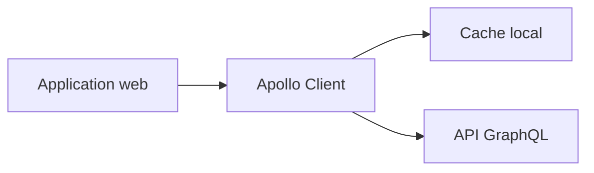

# apollographql/apollo-client

> Client GraphQL pour TypeScript et JavaScript avec cache, pour les applications web (React, Vue, Angular).

## Le problème
Interroger une API GraphQL en gardant un état local cohérent demande beaucoup de code manuel.

## Ce que ça fait vraiment
Un client GraphQL avec cache automatique, indépendant du framework (React, Vue, Angular, Svelte) et typé TypeScript. Le README met en avant la compatibilité React 19. Il propose aussi un skill pour agents IA, des outils de développement (extension VS Code, DevTools) et un cours.

## Comment c'est branché
Schéma simplifié d'après la fiche, sans diagramme fourni.



## Essayer
```sh
npm install @apollo/client graphql
npx skills add apollographql/skills --skill apollo-client
```

## Coût et pièges
Gratuit (MIT). Il faut une API GraphQL en face. Les changements de cibles de transpilation ou de dépendances peuvent survenir en version mineure, selon la politique de versions du README.

## Ce que ce n'est pas
Pas un serveur GraphQL (Apollo Router, GraphOS sont d'autres produits). Pas un outil data ou IA.

## Alternatives
Aucune alternative nommée dans le README.

## Pour toi
À ignorer : client front-end GraphQL, utile seulement si tu construis une application web sur une API GraphQL.

