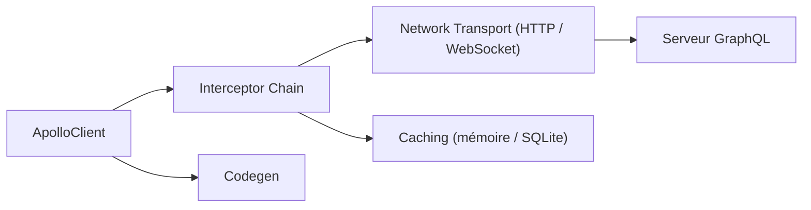

# apollographql/apollo-ios

> Typed GraphQL client in Swift for Apple applications, with caching and code generation.

## The problem
Consuming a GraphQL API in Swift forces you to hand-write models and a cache for the responses.

## What it actually does
Generates Swift models from the schema, runs queries, mutations and subscriptions through a chain of interceptors, and caches in memory or in SQLite. Modules: Apollo, ApolloAPI, ApolloSQLite, ApolloWebSocket, ApolloTestSupport. Installed through Swift Package Manager.

## How it is wired


## Trying it
```swift
dependencies: [
    .package(
        url: "https://github.com/apollographql/apollo-ios.git",
        .upToNextMajor(from: "2.0.0")
    ),
],
```

## Cost and gotchas
Free; requires an existing GraphQL server. The README also promotes the Apollo platform (GraphOS, Router), separately.

## What it is not
Not a GraphQL server nor an AI tool. The README mentions events dated 2025.

## Alternatives
- No alternative cited in the README.

## For you
Ignore: a Swift mobile library, outside the data/AI/MLOps scope.
