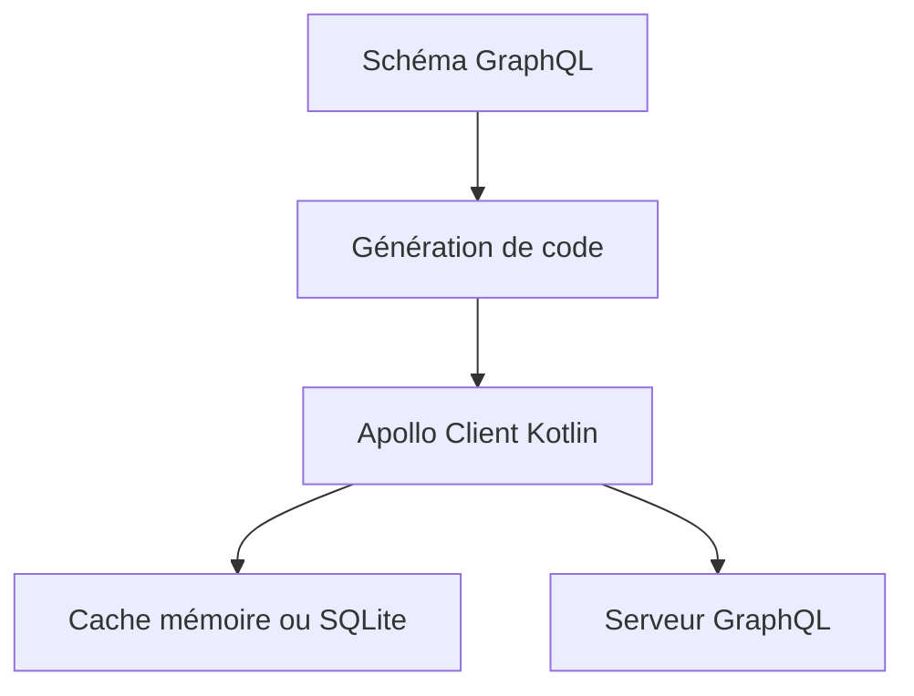

# apollographql/apollo-kotlin

> Typed GraphQL client for Kotlin, Android and multiplatform, with code generation and caching.

## The problem
Calling a GraphQL API by hand means writing models and queries with no type guarantees.

## What it actually does
It generates typed Kotlin code from the GraphQL schema. It provides an in-memory or SQLite cache, and supports persisted queries and `@defer` with GraphOS. It targets Android and Kotlin multiplatform targets. An IntelliJ plugin completes the tooling.

## How it is wired
Simplified diagram based on the sheet, no diagram provided.


## Trying it
```bash
# Aucune commande dans le README : renvoie vers le tutoriel et la documentation.
```

## Cost and gotchas
Free, MIT license. The README is mostly a sales pitch: installation goes through the external documentation. Part of the text promotes the Apollo platform (GraphOS, Router), which is paid for some uses.

## What it is not
Not a GraphQL server, nor a tool for Python. The README publishes no performance figures.

## Alternatives
No alternative named in the README.

## For you
Ignore: a Kotlin client for mobile apps is outside the data, AI and MLOps scope.
