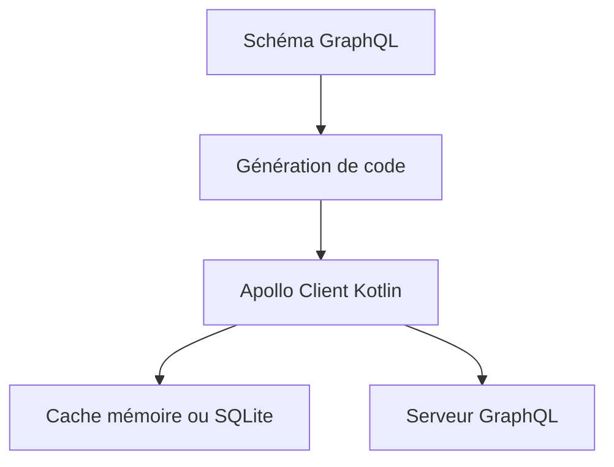

# apollographql/apollo-kotlin

> Client GraphQL typé pour Kotlin, Android et multiplateforme, avec génération de code et cache.

## Le problème
Appeler une API GraphQL à la main impose d'écrire des modèles et des requêtes sans garantie de types.

## Ce que ça fait vraiment
Il génère du code Kotlin typé à partir du schéma GraphQL. Il fournit un cache en mémoire ou SQLite, et prend en charge les requêtes persistées et `@defer` avec GraphOS. Il cible Android et les cibles Kotlin multiplateforme. Un plugin IntelliJ complète l'outillage.

## Comment c'est branché
Schéma simplifié d'après la fiche, sans diagramme fourni.


## Essayer
```bash
# Aucune commande dans le README : renvoie vers le tutoriel et la documentation.
```

## Coût et pièges
Gratuit, licence MIT. Le README est surtout un argumentaire : l'installation passe par la documentation externe. Une partie du texte promeut la plateforme Apollo (GraphOS, Router), payante pour certains usages.

## Ce que ce n'est pas
Pas un serveur GraphQL, ni un outil pour Python. Le README ne publie aucun chiffre de performance.

## Alternatives
Aucune alternative nommée dans le README.

## Pour toi
À ignorer : un client Kotlin pour apps mobiles est hors du périmètre data, IA et MLOps.

