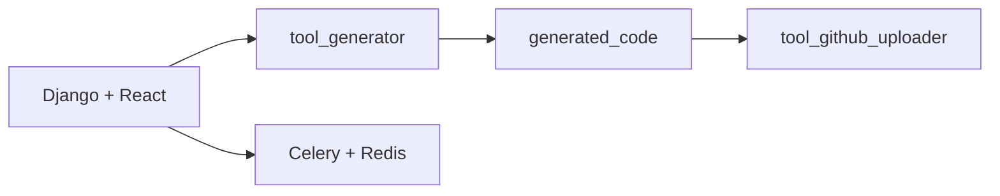

# app-generator/app-generator

> Commercial offer of Django and React application generators with managed services, reserved for PRO subscribers.

## The problem
Quickly produce web applications and business tools without starting from scratch.

## What it actually does
Showcase for a subscription offer: Django templates, managed services (crawlers for websites, X, IMAP, audio and video transcription) and command-line tools (`tool_generator`, `tool_db_migrator`, `tool_inspect_source`). The generated code is available on request. A defensive layer feeds junk data to some AI bots.

## How it is wired
Simplified diagram based on the sheet, no diagram provided.


## Trying it
```bash
virtualenv env
pip install -r requirements.txt
python manage.py migrate
python manage.py runserver
python manage.py dev_tools
```

## Cost and gotchas
Subscription required, code delivered on request. Redis for Celery, Tailwind compiled with pnpm. Archived repository, no license.

## What it is not
Not a free open-source project: a commercial offering. The README does not deliver the code.

## Alternatives
None named in the README.

## For you
Ignore: paid, archived and unlicensed offer, of no value for a data/AI/MLOps profile.
