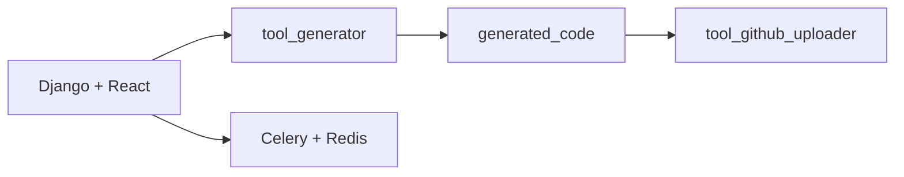

# app-generator/app-generator

> Offre commerciale de générateurs d'applications Django et React avec services gérés, réservée aux abonnés PRO.

## Le problème
Produire rapidement des applications web et des outils métier sans partir de zéro.

## Ce que ça fait vraiment
Vitrine d'une offre par abonnement : gabarits Django, services gérés (crawlers de sites, X, IMAP, transcription audio et vidéo) et outils en ligne de commande (`tool_generator`, `tool_db_migrator`, `tool_inspect_source`). Le code produit est disponible sur demande. Une couche défensive nourrit certains robots d'IA de données poubelle.

## Comment c'est branché
Schéma simplifié d'après la fiche, sans diagramme fourni.


## Essayer
```bash
virtualenv env
pip install -r requirements.txt
python manage.py migrate
python manage.py runserver
python manage.py dev_tools
```

## Coût et pièges
Abonnement requis, code livré sur demande. Redis pour Celery, Tailwind compilé par pnpm. Dépôt archivé, aucune licence.

## Ce que ce n'est pas
Pas un projet open source libre : un support commercial. Le README ne livre pas le code.

## Alternatives
Aucune nommée dans le README.

## Pour toi
À ignorer : offre payante, archivée et sans licence, sans valeur pour un profil data/IA/MLOps.

