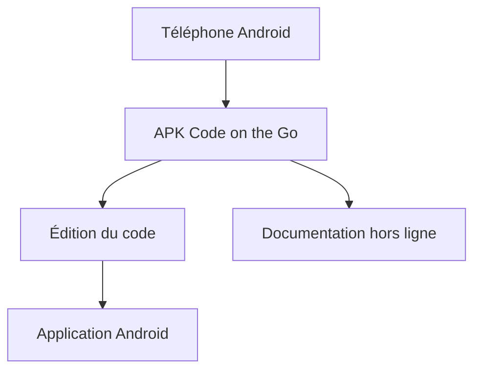

# appdevforall/CodeOnTheGo

> Android IDE that lets you build Android applications directly on a phone, offline.

## The problem
Developing for Android requires a computer and a connection, which excludes those who only have a phone.

## What it actually does
An application installed via APK that serves as a development environment on the phone. It succeeds AndroidIDE, archived in 2024, and ships with offline documentation (Java, Kotlin, Android).

## How it is wired
Simplified diagram based on the sheet, no diagram provided.


## Trying it
```bash
# Aucune commande documentée : télécharger l'APK depuis le site de App Dev for All.
```

## Cost and gotchas
Free, philanthropic scope. GPL-3.0 license (copyleft). 174 open issues.

## What it is not
Not a data or AI tool. The README describes neither the supported languages nor the build chain.

## Alternatives
- AndroidIDE (archived in 2024, of which this is the successor).

## For you
Ignore: outside your data / AI / MLOps scope, unless you have a specific need to code on a phone.
