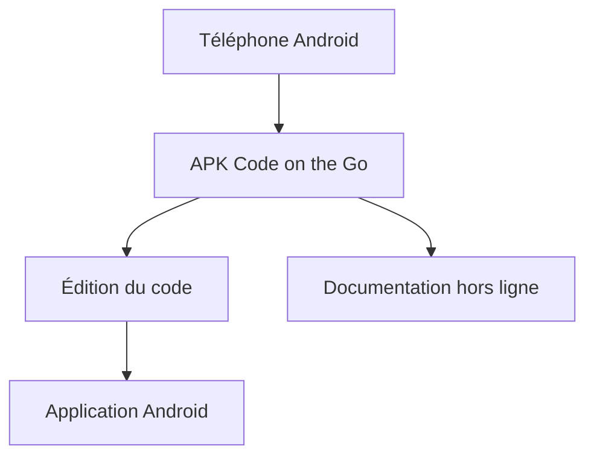

# appdevforall/CodeOnTheGo

> IDE Android qui permet de construire des applications Android directement sur un téléphone, hors ligne.

## Le problème
Développer pour Android exige un ordinateur et une connexion, ce qui exclut ceux qui n'ont qu'un téléphone.

## Ce que ça fait vraiment
Une application installée par APK qui sert d'environnement de développement sur le téléphone. Elle succède à AndroidIDE, archivé en 2024, et embarque de la documentation hors ligne (Java, Kotlin, Android).

## Comment c'est branché
Schéma simplifié d'après la fiche, sans diagramme fourni.


## Essayer
```bash
# Aucune commande documentée : télécharger l'APK depuis le site de App Dev for All.
```

## Coût et pièges
Gratuit, portée philanthropique. Licence GPL-3.0 (copyleft). 174 issues ouvertes.

## Ce que ce n'est pas
Pas un outil data ou IA. Le README ne décrit ni les langages gérés ni la chaîne de build.

## Alternatives
- AndroidIDE (archivé en 2024, dont celui-ci est le successeur).

## Pour toi
À ignorer : hors de ton périmètre data / IA / MLOps, sauf besoin précis de coder sur téléphone.

