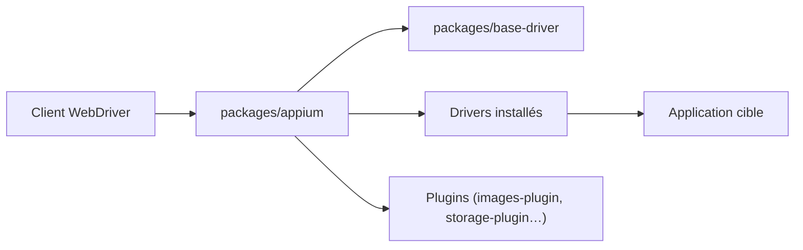

# appium/appium

> Mobile and desktop test automation server via WebDriver, for cross-platform QA teams.

## The problem
Testing a native iOS or Android application otherwise requires one tool and one language per platform (XCUITest, UiAutomator, Espresso).

## What it actually does
A modular Node server (Lerna monorepo) that exposes the WebDriver protocol. The server alone automates nothing: you install drivers per platform (`appium driver install`) and optionally plugins. Clients exist in Java, Python, Ruby and C#. You write tests in the language and framework of your choice, without recompiling the application.

## How it is wired


## Trying it
```bash
npm i -g appium
appium driver install <driver-name>
appium driver list --installed
appium server
appium --use-plugins=<plugin-name>
```

## Cost and gotchas
Free. Node and npm required (other package managers not supported). Each driver has its own prerequisites, to be read in its docs. With Appium 1, the README requires a full uninstall first.

## What it is not
Not a testing framework: it provides neither assertions nor a runner. It has no relation to models or data.

## Alternatives
No alternative cited in the README (XCUITest, UiAutomator and Espresso are cited as the native tools it avoids).

## For you
Ignore: a mobile QA tool unrelated to the data / AI / MLOps profile, unless you have a mobile app to test.
