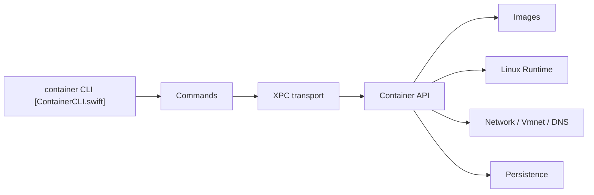

# apple/container

> Swift tool for running Linux containers as lightweight virtual machines on Apple silicon Macs.

## The problem
Running Linux containers on a Mac usually goes through a heavy shared VM.

## What it actually does
A thin CLI that talks over XPC to privileged services (containers API, images, network, Linux runtime, machines). Each container runs in its own lightweight VM, with standard OCI images (pull, build, push). The Containerization package handles the low level; plugins extend the services.

## How it is wired


## Trying it
```bash
container system start
container run --rm alpine echo hello
container system stop
/usr/local/bin/update-container.sh
/usr/local/bin/uninstall-container.sh -k
```

## Cost and gotchas
Requires an Apple silicon Mac and macOS 26; older versions are not supported. The installer asks for the administrator password (`/usr/local`). Non-semantic versioning, experimental features (`k8s`) with no guarantee.

## What it is not
Not a Docker replacement on Linux or Windows, nor an orchestrator. The README documents no GPU access for containers.

## Alternatives
No alternative named in the README.

## For you
Watch: interesting if you develop on a Mac to test images, but dependent on macOS 26 and with no documented GPU support.
