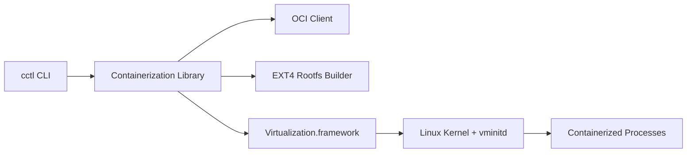

# apple/containerization

> Swift package for running Linux containers, each in its own lightweight virtual machine, on Apple silicon Macs.

## The problem
Running Linux containers on macOS usually goes through a big shared virtual machine; Apple wants per-container isolation.

## What it actually does
Provides APIs to manage OCI images and registries, create ext4 filesystems, talk to Netlink, and launch lightweight virtual machines with an optimized Linux kernel and Rosetta 2. Each container runs in its own VM with its own IP address; `vminitd`, a minimal init, exposes a gRPC API over vsock. A Linux backend exists (cloud-hypervisor + KVM). Version 0.1.0, code stability not guaranteed between minor versions.

## How it is wired


## Trying it
```bash
make all
make test integration
make fetch-default-kernel
make protos
make docs
```

## Cost and gotchas
Free. Requires an Apple silicon Mac, macOS 26 and Xcode 26, as well as the `container` CLI to build the guest. A kernel must be supplied or built.

## What it is not
It is not the CLI for running containers: that one is in apple/container.

## Alternatives
apple/container, a repository dedicated to the command-line binaries.

## For you
Worth watching: interesting for developing on Mac without Docker Desktop, but very recent and limited to Apple silicon; useless for MLOps on a Linux server.
