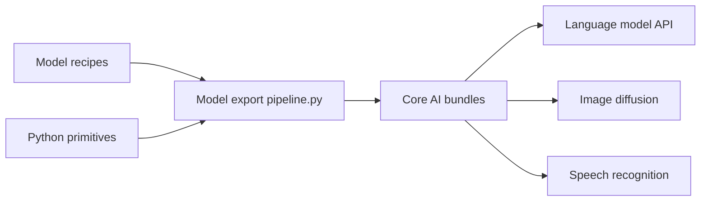

# apple/coreai-models

> Export recipes and Swift utilities to run open models on device with Apple's Core AI.

## The problem
Porting a PyTorch or Hugging Face model to Apple chips requires mastering layout, compression and the KV cache.

## What it actually does
Catalog of export recipes to `.aimodel` files (language, vision, diffusion, speech recognition, detection, segmentation), Python primitives for writing models, a Swift runtime package and a CLI. Three agent skills: `working-with-coreai`, `model-authoring`, `model-compression-exploration`, installable in Claude Code, Codex or Gemini CLI.

## How it is wired


## Trying it
```bash
brew install uv
/plugin marketplace add git@github.com:apple/coreai-models.git
/plugin install coreai-skills@coreai-models
```

## Cost and gotchas
Free, but macOS and iOS 27 and Xcode 27 are required to run. PRs are not accepted at launch; only issues are open.

## What it is not
Not a cross-platform library: it only serves the Apple ecosystem.

## Alternatives
No alternative named in the README.

## For you
Worth watching: useful reference if you deploy models on iPhone or Mac, but of no interest outside the Apple ecosystem.
