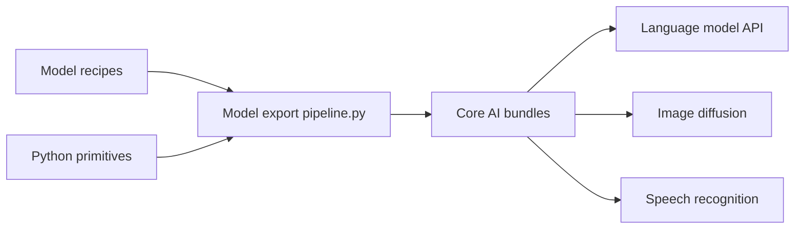

# apple/coreai-models

> Recettes d'export et utilitaires Swift pour faire tourner des modèles ouverts sur appareil avec Core AI d'Apple.

## Le problème
Porter un modèle PyTorch ou Hugging Face sur puces Apple demande de maîtriser la mise en page, la compression et le cache KV.

## Ce que ça fait vraiment
Catalogue de recettes d'export vers des fichiers `.aimodel` (langage, vision, diffusion, reconnaissance vocale, détection, segmentation), primitives Python pour écrire des modèles, paquet Swift d'exécution et CLI. Trois skills d'agent : `working-with-coreai`, `model-authoring`, `model-compression-exploration`, installables dans Claude Code, Codex ou Gemini CLI.

## Comment c'est branché


## Essayer
```bash
brew install uv
/plugin marketplace add git@github.com:apple/coreai-models.git
/plugin install coreai-skills@coreai-models
```

## Coût et pièges
Gratuit, mais macOS et iOS 27 et Xcode 27 sont requis pour exécuter. Les PR ne sont pas acceptées au lancement ; seules les issues sont ouvertes.

## Ce que ce n'est pas
Pas une bibliothèque multiplateforme : elle ne sert qu'à l'écosystème Apple.

## Alternatives
Aucune alternative nommée dans le README.

## Pour toi
À surveiller : référence utile si tu déploies des modèles sur iPhone ou Mac, mais sans intérêt hors écosystème Apple.

