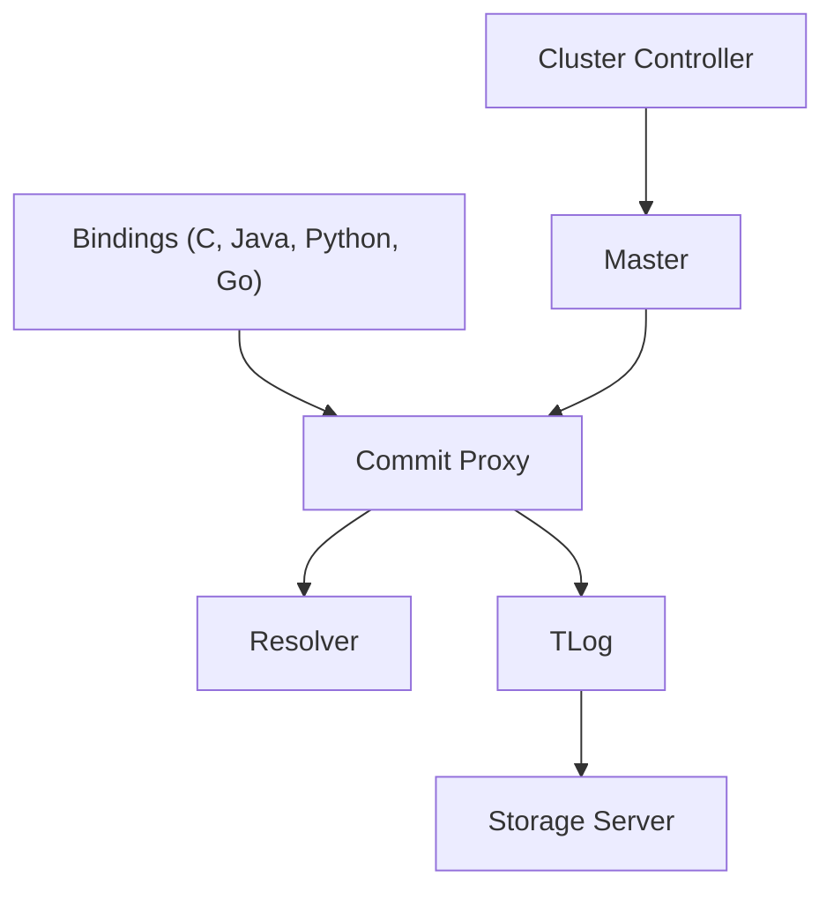

# apple/foundationdb

> Distributed ordered key-value database with ACID transactions, for clusters of commodity servers.

## The problem
Getting ACID transactions on a large volume of distributed data, with good read and write performance.

## What it actually does
Ordered key-value storage, with bindings for several languages (C, Java, Python, Go, Ruby). Server side: Cluster Controller, Commit Proxy, Resolver (conflict detection), TLog, Storage Servers, Coordinators. The asynchronous code relies on C++20 coroutines and the Flow runtime. Branch 7.3 declared "Supported".

## How it is wired


## Trying it
```bash
mkdir /some/build_output_dir
cd /some/build_output_dir
CC=clang CXX=clang++ LD=lld cmake -D USE_LD=LLD -D USE_LIBCXX=1 -G Ninja /some/fdb/source_dir
ninja
```

## Cost and gotchas
Free. Building requires at least 8 GB of memory and many dependencies; the README recommends the `foundationdb/build` Docker image. Binaries are also available for download.

## What it is not
Not a SQL database nor a turnkey product for analysts. Branches 7.0 and 7.2 are experimental, not for production.

## Alternatives
No alternative named in the README.

## For you
Watch: a reference for distributed transactional storage, but heavy to operate, and with no direct link to data science.
