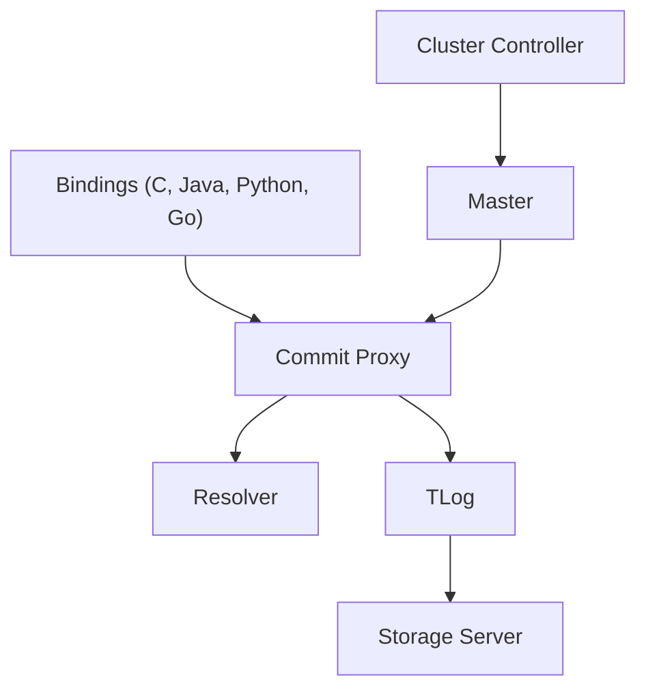

# apple/foundationdb

> Base de données distribuée clé-valeur ordonnée avec transactions ACID, pour grappes de serveurs standard.

## Le problème
Obtenir des transactions ACID sur un grand volume de données réparti, avec de bonnes performances en lecture et en écriture.

## Ce que ça fait vraiment
Stockage clé-valeur ordonné, avec des bindings pour plusieurs langages (C, Java, Python, Go, Ruby). Côté serveur : Cluster Controller, Commit Proxy, Resolver (détection de conflits), TLog, Storage Servers, Coordinators. Le code asynchrone repose sur les coroutines C++20 et le runtime Flow. Branche 7.3 déclarée « Supported ».

## Comment c'est branché


## Essayer
```bash
mkdir /some/build_output_dir
cd /some/build_output_dir
CC=clang CXX=clang++ LD=lld cmake -D USE_LD=LLD -D USE_LIBCXX=1 -G Ninja /some/fdb/source_dir
ninja
```

## Coût et pièges
Gratuit. La compilation exige au moins 8 Go de mémoire et beaucoup de dépendances ; le README recommande l'image Docker `foundationdb/build`. Des binaires sont aussi proposés en téléchargement.

## Ce que ce n'est pas
Pas une base SQL ni un produit clé en main pour analystes. Les branches 7.0 et 7.2 sont expérimentales, pas pour la production.

## Alternatives
Aucune alternative nommée dans le README.

## Pour toi
Surveiller : référence pour un stockage transactionnel distribué, mais lourde à exploiter, et sans lien direct avec la data science.

