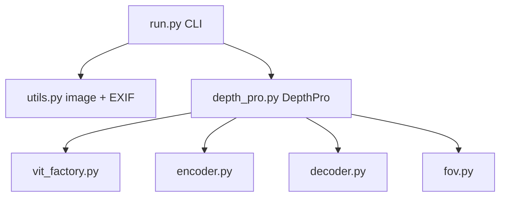

# apple/ml-depth-pro

> Zero-shot monocular metric depth model, with estimated focal length, for vision researchers and engineers.

## The problem
Estimating absolute-scale depth from a single image usually requires camera parameters and slow models.

## What it actually does
Takes an image, reads the EXIF focal length if possible, and outputs a depth map in meters and a focal length in pixels. The README claims 2.25 megapixels in 0.3 s on a standard GPU. Provided: `depth-pro-run` CLI, Python API, boundary metrics. The weights in the repo are retrained: performance close to the paper, without matching it.

## How it is wired


## Trying it
```bash
conda create -n depth-pro -y python=3.9
conda activate depth-pro
pip install -e .
source get_pretrained_models.sh
depth-pro-run -i ./data/example.jpg
```

## Cost and gotchas
Free; checkpoints must be downloaded. The stated timings assume a GPU. License present but not recognized by GitHub: read the license files for the code and the weights.

## What it is not
Not the exact model from the paper. Not a service. Usage terms of the weights are not settled here.

## Alternatives
No alternative named in the README.

## For you
Keep an eye on it: a good candidate for 3D vision or robotics, provided you read the license before any use beyond research.
