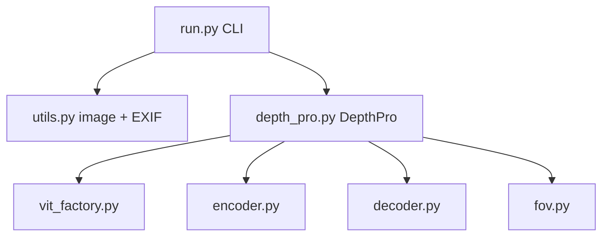

# apple/ml-depth-pro

> Modèle de profondeur métrique monoculaire en zéro-shot, avec focale estimée, pour chercheurs et ingénieurs vision.

## Le problème
Estimer une profondeur à échelle absolue depuis une seule image demande d'ordinaire les paramètres de la caméra et des modèles lents.

## Ce que ça fait vraiment
Prend une image, lit si possible la focale EXIF, sort une carte de profondeur en mètres et une focale en pixels. Le README annonce 2,25 mégapixels en 0,3 s sur GPU standard. Fourni : CLI `depth-pro-run`, API Python, métriques de frontière. Les poids du dépôt sont ré-entraînés : performance proche du papier, sans l'égaler.

## Comment c'est branché


## Essayer
```bash
conda create -n depth-pro -y python=3.9
conda activate depth-pro
pip install -e .
source get_pretrained_models.sh
depth-pro-run -i ./data/example.jpg
```

## Coût et pièges
Gratuit ; checkpoints à télécharger. Les temps annoncés supposent un GPU. Licence présente mais non reconnue par GitHub : relire les fichiers de licence du code et des poids.

## Ce que ce n'est pas
Pas le modèle exact du papier. Pas un service. Conditions d'usage des poids non tranchées ici.

## Alternatives
Aucune alternative nommée dans le README.

## Pour toi
À surveiller : bon candidat pour de la vision 3D ou de la robotique, à condition de lire la licence avant tout usage hors recherche.

