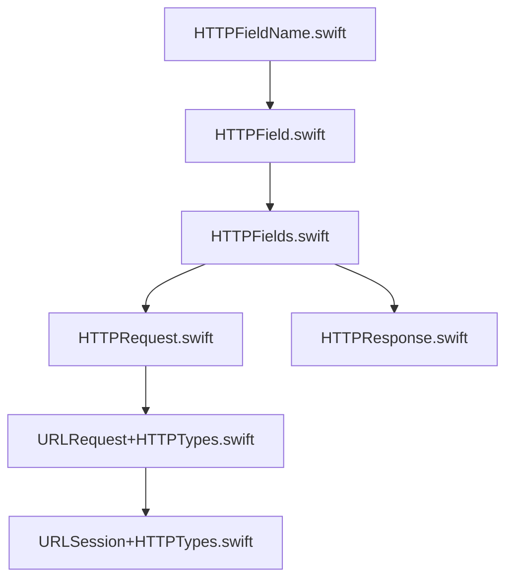

# apple/swift-http-types

> HTTP-version-independent Swift types to represent requests and responses, on both client and server.

## The problem
Version-specific HTTP types complicate code shared between Swift clients and servers.

## What it actually does
`HTTPTypes` defines `HTTPRequest`, `HTTPResponse`, `HTTPFields` and the HTTP/2 and HTTP/3 error codes. `HTTPTypesFoundation` converts to `URLRequest` and `URLResponse` and adds `URLSession` methods. The SwiftNIO adapters are in `swift-nio-extras`.

## How it is wired


## Trying it
```swift
dependencies: [
    .package(url: "https://github.com/apple/swift-http-types.git", from: "1.0.0")
]
let request = HTTPRequest(method: .get, scheme: "https", authority: "www.example.com", path: "/")
```

## Cost and gotchas
Free. The Swift toolchain is required; the NIO adapters come from another repository.

## What it is not
Not an HTTP client: only data types.

## Alternatives
No alternative named in the README.

## For you
Ignore: a low-level Swift library, outside your domain.
