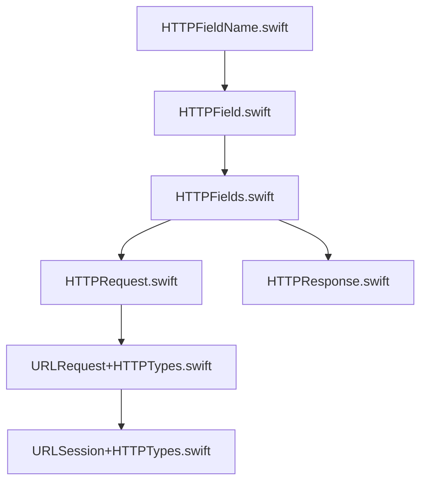

# apple/swift-http-types

> Types Swift indépendants de la version HTTP pour représenter requêtes et réponses, côté client et serveur.

## Le problème
Les types HTTP spécifiques à chaque version compliquent le code partagé entre clients et serveurs Swift.

## Ce que ça fait vraiment
`HTTPTypes` définit `HTTPRequest`, `HTTPResponse`, `HTTPFields` et les codes d'erreur HTTP/2 et HTTP/3. `HTTPTypesFoundation` convertit vers `URLRequest` et `URLResponse` et ajoute des méthodes `URLSession`. Les adaptateurs SwiftNIO sont dans `swift-nio-extras`.

## Comment c'est branché


## Essayer
```swift
dependencies: [
    .package(url: "https://github.com/apple/swift-http-types.git", from: "1.0.0")
]
let request = HTTPRequest(method: .get, scheme: "https", authority: "www.example.com", path: "/")
```

## Coût et pièges
Gratuit. Il faut la chaîne d'outils Swift ; les adaptateurs NIO viennent d'un autre dépôt.

## Ce que ce n'est pas
Pas un client HTTP : seulement des types de données.

## Alternatives
Aucune alternative nommée dans le README.

## Pour toi
À ignorer : bibliothèque Swift bas niveau, hors de ton domaine.

