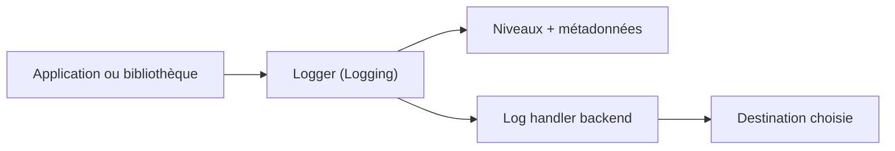

# apple/swift-log

> Unified logging API for Swift, adopted by libraries and applications across the ecosystem.

## The problem
Each Swift library logs in its own way, which prevents centralizing logs.

## What it actually does
Provides a logger API (levels, metadata) without imposing a destination. Actual storage goes through community backends to choose from. Integration through Swift Package Manager; a CMake build exists without the tests.

## How it is wired
Simplified diagram based on the sheet, no diagram provided.



## Trying it
```swift
.package(url: "https://github.com/apple/swift-log", from: "1.6.0")
```
```swift
import Logging
let logger = Logger(label: "com.example.YourApp")
logger.info("Application started")
```

## Cost and gotchas
Free. It is an API only: a backend is needed for real production use.

## What it is not
It is not a log collection system or a backend: it writes nothing by itself. It is only for Swift code.

## Alternatives
No alternative named in the README.

## For you
Ignore it: an excellent API for server-side Swift or Apple, unrelated to a Python data / AI / MLOps profile.
