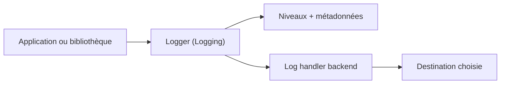

# apple/swift-log

> API de journalisation unifiée pour Swift, adoptée par les bibliothèques et applications de l'écosystème.

## Le problème
Chaque bibliothèque Swift journalise à sa façon, ce qui empêche de centraliser les logs.

## Ce que ça fait vraiment
Fournit une API de logger (niveaux, métadonnées) sans imposer de destination. Le stockage réel passe par des backends communautaires à choisir. Intégration par Swift Package Manager ; un build CMake existe sans les tests.

## Comment c'est branché
Schéma simplifié d'après la fiche, sans diagramme fourni.



## Essayer
```swift
.package(url: "https://github.com/apple/swift-log", from: "1.6.0")
```
```swift
import Logging
let logger = Logger(label: "com.example.YourApp")
logger.info("Application started")
```

## Coût et pièges
Gratuit. C'est une API seule : un backend est nécessaire pour un usage réel en production.

## Ce que ce n'est pas
Ce n'est pas un système de collecte de logs ni un backend : il n'écrit rien par lui-même. Il ne sert que pour du code Swift.

## Alternatives
Aucune alternative nommée dans le README.

## Pour toi
À ignorer : excellente API pour Swift côté serveur ou Apple, sans rapport avec un profil data / IA / MLOps en Python.

