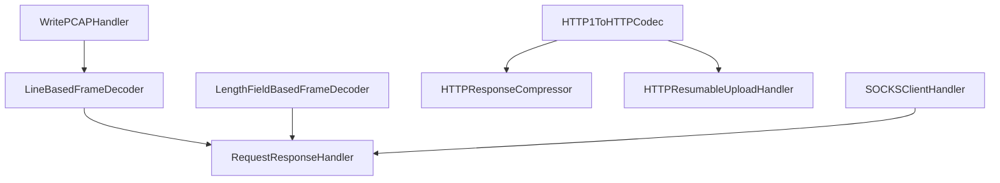

# apple/swift-nio-extras

> Collection of channel handlers that complement SwiftNIO: codecs, HTTP, SOCKS, NFS3 and PCAP capture.

## The problem
The SwiftNIO core leaves out common codecs and helpers that are too small for a separate repository.

## What it actually does
Provides frame decoders (line-based, fixed-length, length-field), a request-response handler, HTTP compression, HTTP/1 and HTTP/2 translation to shared types, resumable uploads, debug handlers and WritePCAPHandler to inspect traffic in Wireshark.

## How it is wired


## Trying it
```swift
.package(url: "https://github.com/apple/swift-nio-extras.git", from: "1.0.0"),
```

## Cost and gotchas
Free. Requires Swift 5.7.1, swift-nio 2.30 or later and zlib with its headers: the Swift requirement is missing from the prerequisites list.

## What it is not
Not a web server: building blocks for constructing Swift network pipelines.

## Alternatives
No alternative named in the README.

## For you
Ignore: Swift network programming, outside your data, AI or MLOps scope.
