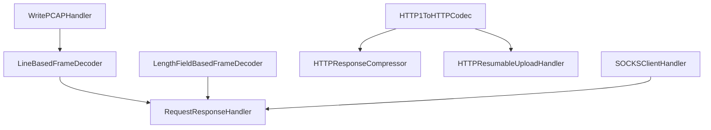

# apple/swift-nio-extras

> Collection de gestionnaires de canaux complémentaires à SwiftNIO : codecs, HTTP, SOCKS, NFS3 et capture PCAP.

## Le problème
Le cœur de SwiftNIO laisse de côté des codecs courants et des aides trop petites pour un dépôt à part.

## Ce que ça fait vraiment
Fournit décodeurs de trames (lignes, longueur fixe, champ de longueur), gestionnaire requête-réponse, compression HTTP, traduction HTTP/1 et HTTP/2 vers des types partagés, envois reprenables, handlers de débogage et WritePCAPHandler pour inspecter le trafic dans Wireshark.

## Comment c'est branché


## Essayer
```swift
.package(url: "https://github.com/apple/swift-nio-extras.git", from: "1.0.0"),
```

## Coût et pièges
Gratuit. Swift 5.7.1, swift-nio 2.30 ou plus et zlib avec ses en-têtes : le besoin Swift n'existe pas dans la liste des prérequis.

## Ce que ce n'est pas
Pas un serveur web : des briques pour construire des pipelines réseau Swift.

## Alternatives
Aucune alternative nommée dans le README.

## Pour toi
À ignorer : de la programmation réseau Swift, hors de ton périmètre data, IA ou MLOps.

