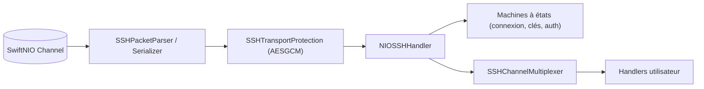

# apple/swift-nio-ssh

> Programmatic implementation of the SSH protocol on SwiftNIO, for building SSH clients and servers in Swift.

## The problem
Running remote commands or port forwarding from a Swift service forces you to launch an `ssh` client as a subprocess.

## What it actually does
Provides `NIOSSHHandler`, a SwiftNIO handler that implements SSH: key exchange, delegate-based authentication, child channels (`session`, `directTCPIP`, `forwardedTCPIP`), port forwarding. Closer to libssh2 than to OpenSSH, it ships no production client or server, only examples and a performance tester.

## How it is wired

## Trying it
Add a SwiftPM dependency: the README gives no command. Recommended setting: `channel.setOption(ChannelOptions.allowRemoteHalfClosure, true)`.

## Cost and gotchas
Free. Recent versions require Swift 6.1. Without half-closure enabled, child channels behave unexpectedly.

## What it is not
It is not a ready-to-use SSH client or server; you have to write the authentication and channel logic.

## Alternatives
- libssh2: use-case comparison.
- OpenSSH: the README contrasts it as a complete tool.

## For you
Ignore: low-level Swift building block, no use for a data/AI/MLOps profile outside server-side Swift development.
