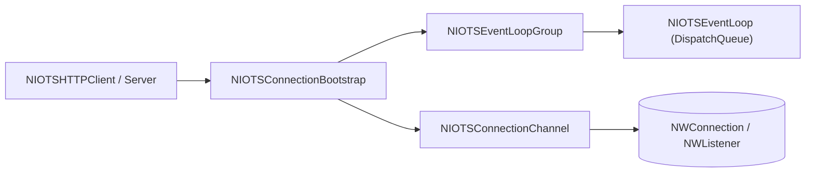

# apple/swift-nio-transport-services

> SwiftNIO extension that uses Network.framework and Dispatch for native networking on Apple platforms.

## The problem
On Apple platforms, SwiftNIO uses POSIX sockets and ignores the strengths of Network.framework (waiting for a route, proxy, VPN).

## What it actually does
Provides an alternative `EventLoop` and `EventLoopGroup`, channels (connection, listening, datagram) and bootstraps built on `NWConnection` and `NWListener`. An existing SwiftNIO application works by switching event loops and bootstraps. Two example executables (HTTP client and server) are included.

## How it is wired


## Trying it
```swift
.package(url: "https://github.com/apple/swift-nio-transport-services.git", from: "1.13.0")
```
Then add the `NIOTransportServices` module to the target.

## Cost and gotchas
Free; requires `swift-nio`, an Apple system with Network.framework and Swift 6.1 for recent versions.

## What it is not
It is not a replacement for SwiftNIO: it is an extension reserved for Apple platforms.

## Alternatives
The README names no alternative (the implicit reference is standard SwiftNIO).

## For you
Ignore: a low-level Swift networking building block, no use for a data/AI/MLOps profile.
