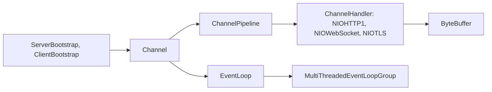

# apple/swift-nio

> Event-driven asynchronous network framework for Swift, comparable to Netty, for protocol servers and clients.

## The problem
A "one thread per connection" model does not hold up when a server handles a large number of mostly idle connections.

## What it actually does
Provides event loops (`EventLoop`), channels (`Channel`), `ChannelHandler` pipelines, copy-on-write `ByteBuffer`s and `EventLoopFuture/Promise`. Modules include `NIOCore`, `NIOPosix`, `NIOEmbedded` (testing), `NIOHTTP1`, `NIOWebSocket`, `NIOTLS`. TLS, HTTP/2 and SSH live in other repositories. The README states that most users will go through a web framework rather than using NIO directly.

## How it is wired


## Trying it
```bash
swift run NIOHTTP1Server
swift run TARGET_NAME
```
To add it to a project: dependency `.package(url: "https://github.com/apple/swift-nio.git", from: "2.0.0")` in `Package.swift`.

## Cost and gotchas
Free. `ChannelHandler`s must not call blocking code without offloading it, or they will block every channel on the loop. Minimum Swift version is rising (6.1 since 2.98.0).

## What it is not
It is not a web framework: it provides low-level building blocks. It does not include TLS or HTTP/2, which are in other repositories.

## Alternatives
Netty (Java) is cited as the model; the README also points to higher-level libraries (async-http-client, grpc-swift, PostgresNIO).

## For you
Ignore: Swift networking building block, outside the data/AI/MLOps stack.
