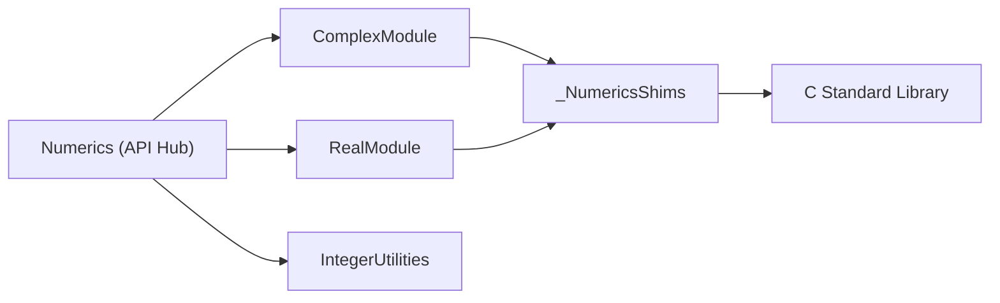

# apple/swift-numerics

> Swift numerical computing modules (complex numbers, real functions) close to the standard library.

## The problem
The Swift standard library offers neither complex numbers nor portable generic mathematical functions.

## What it actually does
Three modules: `RealModule` (Real protocol and elementary functions), `ComplexModule` (`Complex<Double>` etc.), `IntegerUtilities` (on main only, not yet in a tag). A `Numerics` module re-exports everything. Semantic versioning, public API defined excluding underscored elements. Possible future extensions mentioned: big integers, arbitrary precision, arrays, decimals.

## How it is wired


## Trying it
```swift
.package(url: "https://github.com/apple/swift-numerics", from: "1.0.0"),
.product(name: "Numerics", package: "swift-numerics"),
```
```swift
import Numerics
```

## Cost and gotchas
Free. New versions may require a more recent Swift toolchain (minor bump).

## What it is not
Not a NumPy equivalent: no arrays or linear algebra today (BLAS/LAPACK mentioned as a future possibility).

## Alternatives
No alternative named in the README.

## For you
Ignore: useful only if you write numerical Swift; for data, the Python ecosystem is far better equipped.
