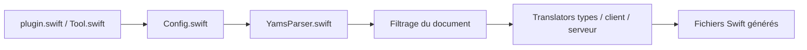

# apple/swift-openapi-generator

> Swift package plugin that generates a client and server from an OpenAPI document, for Swift developers.

## The problem
Hand-writing HTTP call and service code from an OpenAPI specification is repetitive.

## What it actually does
At build time, reads an OpenAPI 3.0/3.1 document (3.2 preliminary), validates it, translates it into Swift (types, client, server) and renders the files; the code does not need to be versioned. Streaming bodies, JSON, multipart, forms, base64. Decoupled transports: URLSession, AsyncHTTPClient, Vapor, Hummingbird, AWS Lambda in other repositories.

## How it is wired


## Trying it
```swift
import OpenAPIURLSession
let client = Client(
    serverURL: URL(string: "http://localhost:8080/api")!,
    transport: URLSessionTransport()
)
let response = try await client.getGreeting()
```

## Cost and gotchas
Free. The project is spread across several repositories (runtime, transports) that you need to add.

## What it is not
Not a multi-language generator: it only produces Swift.

## Alternatives
No alternative named in the README.

## For you
Ignore: only useful for Swift; in Python you will use a different API generator.
