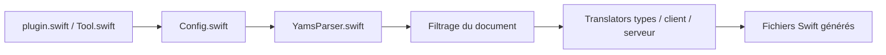

# apple/swift-openapi-generator

> Plugin de paquet Swift qui génère client et serveur à partir d'un document OpenAPI, pour développeurs Swift.

## Le problème
Écrire à la main le code d'appel et de service HTTP à partir d'une spécification OpenAPI est répétitif.

## Ce que ça fait vraiment
Au moment du build, lit un document OpenAPI 3.0/3.1 (3.2 préliminaire), le valide, le traduit en Swift (types, client, serveur) et rend les fichiers ; le code n'a pas à être versionné. Corps en streaming, JSON, multipart, formulaires, base64. Transports découplés : URLSession, AsyncHTTPClient, Vapor, Hummingbird, AWS Lambda dans d'autres dépôts.

## Comment c'est branché


## Essayer
```swift
import OpenAPIURLSession
let client = Client(
    serverURL: URL(string: "http://localhost:8080/api")!,
    transport: URLSessionTransport()
)
let response = try await client.getGreeting()
```

## Coût et pièges
Gratuit. Le projet est réparti sur plusieurs dépôts (runtime, transports) à ajouter.

## Ce que ce n'est pas
Pas un générateur multi-langages : il ne produit que du Swift.

## Alternatives
Aucune alternative nommée dans le README.

## Pour toi
À ignorer : utile seulement pour du Swift ; en Python tu auras un autre générateur d'API.

