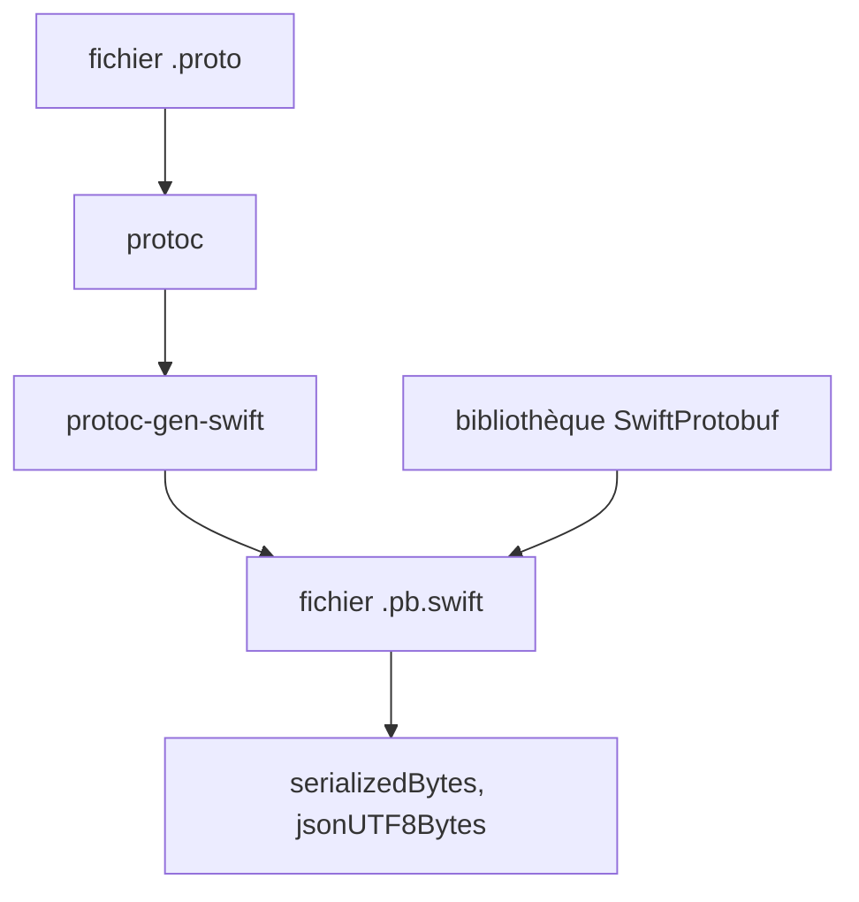

# apple/swift-protobuf

> protoc plugin and runtime library that generate Swift code from .proto files.

## The problem
Serializing Protocol Buffers messages by hand in Swift is error-prone.

## What it actually does
The `protoc-gen-swift` plugin turns `.proto` files into Swift structures (value types, `Hashable`, `Equatable`), with compact binary serialization and standard JSON. The `SwiftProtobuf` library is added to the project via SwiftPM, Xcode or CocoaPods. The format remains compatible with the other protobuf languages.

## How it is wired
Simplified diagram based on the sheet, no diagram provided.



## Trying it
```bash
git clone https://github.com/apple/swift-protobuf.git
cd swift-protobuf
git checkout tags/[tag_name]
swift build -c release
protoc --swift_out=. my.proto
```

## Cost and gotchas
Free. Swift compiler 6.1 or later (Xcode 16.3) and Google's `protoc`. Use the library version that matches the plugin's.

## What it is not
Not a generic data tool: it only concerns Swift. Not a replacement for `protoc`, which it depends on.

## Alternatives
No alternative cited in the README (the same `.proto` can generate Java, C++, Python or Objective-C).

## For you
Ignore unless you develop in Swift: protobuf in Python is handled without this repository.
