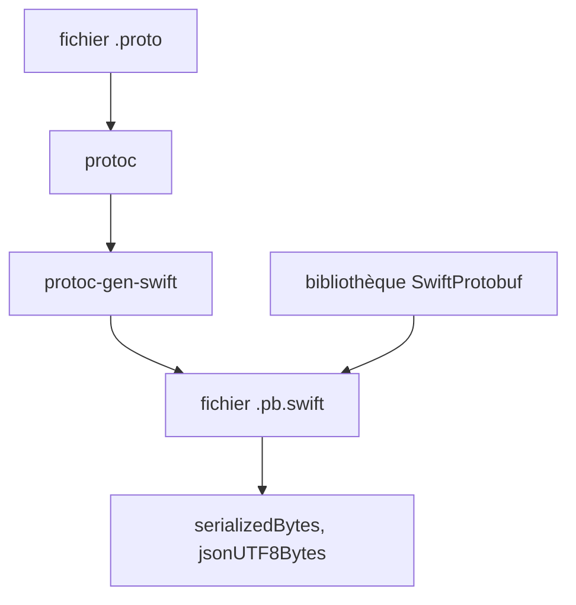

# apple/swift-protobuf

> Plugin protoc et bibliothèque d'exécution qui génèrent du code Swift à partir de fichiers .proto.

## Le problème
Sérialiser des messages Protocol Buffers à la main en Swift est source d'erreurs.

## Ce que ça fait vraiment
Le plugin `protoc-gen-swift` transforme les `.proto` en structures Swift (valeur, `Hashable`, `Equatable`), avec sérialisation binaire compacte et JSON standard. La bibliothèque `SwiftProtobuf` est ajoutée au projet via SwiftPM, Xcode ou CocoaPods. Le format reste compatible avec les autres langages protobuf.

## Comment c'est branché
Schéma simplifié d'après la fiche, sans diagramme fourni.



## Essayer
```bash
git clone https://github.com/apple/swift-protobuf.git
cd swift-protobuf
git checkout tags/[tag_name]
swift build -c release
protoc --swift_out=. my.proto
```

## Coût et pièges
Gratuit. Compilateur Swift 6.1 ou plus (Xcode 16.3) et `protoc` de Google. Utiliser la version de la bibliothèque qui correspond à celle du plugin.

## Ce que ce n'est pas
Pas un outil de données générique : il ne concerne que Swift. Pas un remplaçant de `protoc`, dont il dépend.

## Alternatives
Aucune alternative citée dans le README (le même `.proto` peut générer Java, C++, Python ou Objective-C).

## Pour toi
À ignorer sauf si tu développes en Swift : protobuf en Python se gère sans ce dépôt.

