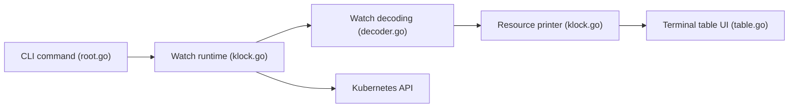

# applejag/kubectl-klock

> kubectl plugin that continuously and readably displays the result of `kubectl get --watch`.

## The problem
`kubectl get pods --watch` piles up unreadable lines; `watch kubectl get pods` polls instead of receiving updates.

## What it actually does
Uses the API watch mechanism to update an interactive table in the same format as `kubectl get`: pagination, filter, live-updating age column, colors, deleted rows kept briefly, restart if the kubeconfig changes.

## How it is wired


## Trying it
```bash
kubectl krew install klock
kubectl klock pods
kubectl klock pods -o wide
kubectl klock pods -A
kubectl klock pods --watch-kubeconfig
```

## Cost and gotchas
Free. Requires access to a cluster. GPL-3.0 license. Completion requires adding `kubectl_complete-klock` to the PATH.

## What it is not
Not a dashboard or an administration tool: it only observes.

## Alternatives
kubecolor (color engine used, not presented as an alternative).

## For you
Adopt: immediate gain for following the pods and deployments of your ML jobs on Kubernetes, at no cost.
