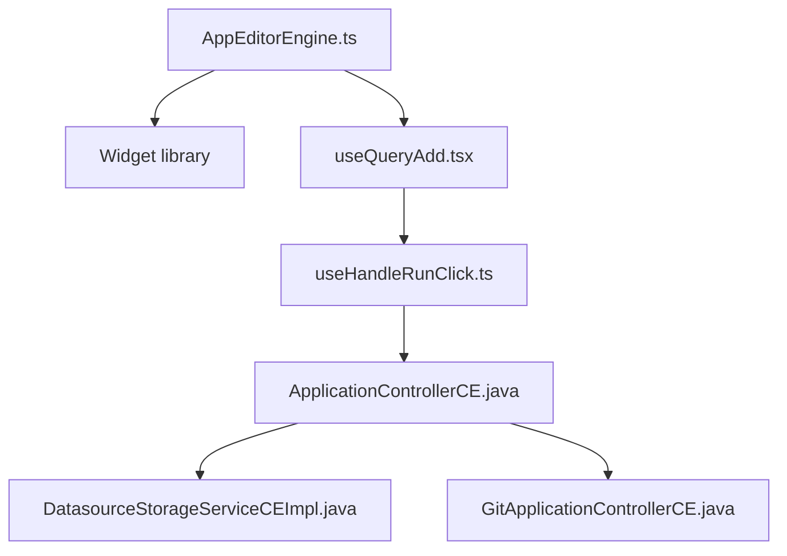

# appsmithorg/appsmith

> Open-source low-code platform for building dashboards and internal tools.

## The problem
Teams need internal tools (admin, dashboards) without developing them entirely.

## What it actually does
Visual widget editor, connection to data sources and queries, Git workflows, application import/export. Java server with plugins; the README also promotes "Appsmith Agents", an AI agents offering.

## How it is wired

## Trying it
No command in the README: installation via the documentation guides (Docker recommended, Kubernetes, AWS AMI) or Appsmith Cloud.

## Cost and gotchas
Self-hosting is free; Appsmith Cloud and Agents are offers from the vendor. 4,527 open issues.

## What it is not
Not fully no-code: queries and JavaScript are still needed. The server links in the diagram are unverified.

## Alternatives
No alternative named in the README.

## For you
Watch: handy for putting an interface on data or a model without a dedicated front end, but heavy to host.
